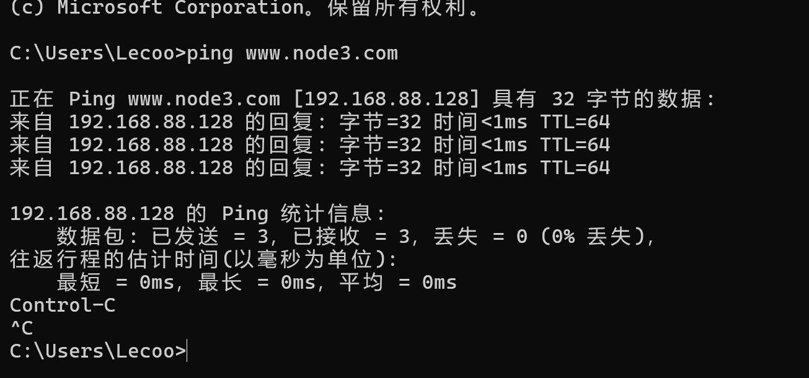
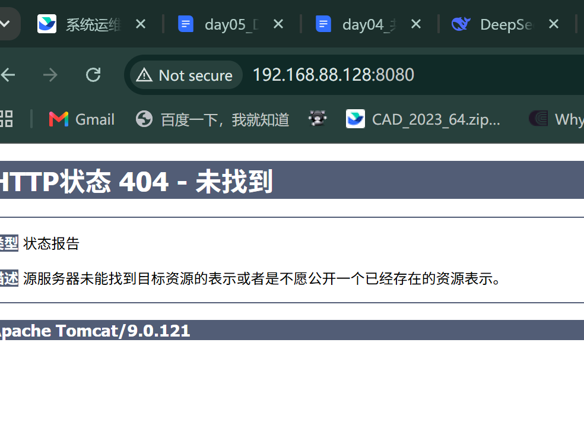



这套实验表面上只是搭建 FTP、DNS 和 Tomcat，实际排查却跨越了普通文件权限、ACL、SELinux、firewalld、DNS 记录和软件包拆分等多个层次。本文按照“现象、检查、根因、修复、验证”的顺序记录整个过程，方便后续复现。

实验环境：

| 主机    | IP 地址            | 主要角色                          |
| ----- | ---------------- | ----------------------------- |
| node1 | `192.168.88.128` | FTP、Tomcat，承载 `www.node3.com` |
| node2 | `192.168.88.129` | 客户端测试                         |
| node3 | `192.168.88.131` | DNS 服务端                       |

预期解析关系：

| 名称              | 地址               | 用途                 |
| --------------- | ---------------- | ------------------ |
| `www.node3.com` | `192.168.88.128` | 访问 node1 上的 Tomcat |
| `node3`         | `192.168.88.131` | DNS 服务端            |

## 问题总览

| 现象                                 | 根因                                | 处理方向                     |
| ---------------------------------- | --------------------------------- | ------------------------ |
| `useradd ftp` 提示用户已存在，登录后也没有预期的家目录 | 使用了软件包已经创建的服务账号 `ftp`             | 创建独立 FTP 用户              |
| FTP 可以登录和建目录，但无法上传文件               | 目录权限、vsftpd 配置和 SELinux 上下文同时存在问题 | 分别检查 Unix 权限、ACL、SELinux |
| DNS 服务启动失败                         | 反向解析区中误用了 A 记录                    | 改为 PTR 记录并执行配置检查         |
| node1、node2 无法通过 node3 提供的 DNS 解析域名 | DNS 53 端口规则未永久生效                  | 将 `dns` 服务永久加入 firewalld |
| 浏览器无法打开 Tomcat                     | 8080 端口未放行                        | 永久开放 `8080/tcp`          |
| 8080 可以访问，但显示 404                  | CentOS 包没有同时安装默认 ROOT 应用          | 安装 `tomcat-webapps`      |

## 一、FTP：账号可以登录，但无法写入

### 1. 不要复用 `ftp` 服务账号

最初为了“见名知意”，尝试直接创建名为 `ftp` 的账号并给它设置测试密码。命令执行后只看到“用户已经存在”，但后续登录时没有预期目录，也无法正常写入。


原因是 `vsftpd` 软件包通常已经创建了名为 `ftp` 的系统服务账号。该账号用于服务内部管理，不应作为普通 FTP 登录账号复用。

先检查账号是否已经存在：

```bash
getent passwd ftp
```

正确做法是创建独立的业务用户，例如 `ftpuser`：

```bash
groupadd ftpusers
useradd -m -G ftpusers -s /bin/bash ftpuser
passwd ftpuser
```

不要继续在文章中保存真实密码。示例环境可以使用测试密码，公开时一律使用占位符。


删除并重新创建用户后，问题仍然存在。进一步检查才发现，目录、账号和服务的表面信息虽然正确，但必须继续核对 ACL、SELinux 上下文和 vsftpd 配置。


### 2. chroot 目录和上传目录分开

推荐让用户被限制在 `/export/ftp`，但该目录本身不可写；真正用于上传的 `/export/ftp/share` 允许该用户组写入：

```bash
chown root:root /export/ftp
chmod 755 /export/ftp

chown root:ftpusers /export/ftp/share
chmod 2770 /export/ftp/share
```

如果使用 ACL，则必须明确写出用户和权限：

```bash
setfacl -m u:ftpuser:rwx /export/ftp/share
setfacl -d -m u:ftpuser:rwx /export/ftp/share
```

原稿中的：

```bash
setfacl -R -m /export/ftp
setfacl -R -d -m /export/ftp
```

缺少 `u:<用户>:<权限>`，不能达到预期效果。

vsftpd 的基础配置建议至少包含：

```ini
local_enable=YES
write_enable=YES
chroot_local_user=YES
allow_writeable_chroot=NO
```

这里的核心思路是让 chroot 根目录保持不可写，把写权限放到子目录中，而不是通过 `allow_writeable_chroot=YES` 放宽限制。

修改后重启：

```bash
systemctl enable --now vsftpd
systemctl restart vsftpd
```

### 3. PUT 失败时要检查 SELinux

可以登录、可以执行 `MKD`，但上传文件时报权限错误，说明账号和基础连接没问题，需要继续检查服务端目录写权限与 SELinux。


先确认 SELinux 状态：

```bash
getenforce
```

为 FTP 共享目录设置正确的上下文：

```bash
dnf install -y policycoreutils-python-utils
semanage fcontext -a -t public_content_rw_t '/export/ftp(/.*)?'
restorecon -Rv /export/ftp
ls -Zd /export/ftp /export/ftp/share
```

如果策略已经存在，将 `-a` 改为 `-m`。发生拒绝时，用下面的命令查看最新 AVC：

```bash
ausearch -m AVC -ts recent
getsebool -a | grep ftp
```

原稿把 FTP 目录设置成了 `nfs_t`，这与当前场景不匹配。后来改成 `usr_t` 虽然能够写入，但也不应作为推荐配置，因为它扩大了进程可访问的文件范围。

只有在确认策略需要时才启用对应布尔值。例如匿名 FTP 写入通常需要检查 `ftpd_anon_write`；`ftpd_full_access` 权限范围很宽，只适合临时实验，不建议作为生产环境的默认方案：

```bash
setsebool -P ftpd_full_access on
```

修复上下文和权限后，再次上传文件：


## 二、DNS：反向记录与永久防火墙

### 1. 反向解析必须使用 PTR 记录

启动 DNS 服务时报错，先检查服务状态和配置：

```bash
systemctl status named --no-pager -l
journalctl -u named -n 100 --no-pager
named-checkconf
```


根因是反向解析区文件中误用了 A 记录。正向记录和反向记录的含义不同：

```dns
; 正向解析：名称 -> IP
www.node3.com.                IN A    192.168.88.128

; 反向解析：IP -> 名称
128.88.168.192.in-addr.arpa.  IN PTR  www.node3.com.
```

反向区的 owner name 仍然表示 IP 对应的反向名称，但资源记录类型必须是 `PTR`，右侧才是主机名称。


修改后，分别检查配置与区文件：

```bash
named-checkconf
named-checkzone 88.168.192.in-addr.arpa /var/named/88.168.192.rev
```

实际文件名应以实验环境为准。重新加载 DNS 服务：

```bash
systemctl restart named
```


### 2. 区分系统解析器与权威 DNS

node3 的 `/etc/resolv.conf` 可以配置为 `1.1.1.1` 用于访问互联网，但这不代表 node3 本机无法查询自己的权威区。测试权威服务时应显式指定 DNS 服务器：

```bash
dig @192.168.88.131 www.node3.com A
dig @192.168.88.131 -x 192.168.88.128
```

`dig` 默认会读取系统 DNS 配置；`dig @server` 则直接向指定服务器发出查询。两者用途不同。


node1 和 node2 需要把 DNS 指向 node3。可以通过 NetworkManager 配置，也可以在实验环境中修改 `/etc/resolv.conf`：

```bash
cat /etc/resolv.conf
getent ahostsv4 www.node3.com
```

不要把 `ping` 当作 DNS 测试命令。域名可以成功解析但 ICMP 被拦截，也可能出现“解析正常但无法 ping”的情况。验证顺序应为：

```bash
dig @192.168.88.131 www.node3.com A
getent ahostsv4 www.node3.com
ping -c 3 www.node3.com
```

### 3. 将 DNS 规则永久加入 firewalld

配置完成后，node1 和 node2 仍无法通过 node3 提供的 DNS 解析域名。检查时发现 DNS 的临时规则没有保存为永久规则。


使用 firewalld 的 `dns` 服务定义，同时覆盖 TCP 和 UDP 的 53 端口：

```bash
firewall-cmd --permanent --add-service=dns
firewall-cmd --reload
firewall-cmd --query-service=dns
firewall-cmd --list-all
firewall-cmd --permanent --list-all
```

如果已经添加了运行时规则，也可以将其整体保存：

```bash
firewall-cmd --runtime-to-permanent
```

`--runtime-to-permanent` 会把当前 zone 的全部运行时规则一起保存，不只保存 DNS。仅添加 `--permanent` 规则后，必须执行 `firewall-cmd --reload`；只在当前运行时添加规则，则系统重启或重载后可能丢失。


最后从 node1 和 node2 验证：

```bash
dig @192.168.88.131 www.node3.com A
ping -c 3 www.node3.com
```



## 三、Tomcat：端口、404 和默认页面

安装并启动 Tomcat：

```bash
dnf install -y tomcat tomcat-webapps
systemctl enable --now tomcat
systemctl status tomcat --no-pager
ss -lntp | grep ':8080'
```

在 CentOS/RHEL 中，`tomcat-webapps` 是独立软件包，负责提供默认的 `ROOT` 应用。只安装 `tomcat` 时，Tomcat 可以正常监听 8080，但访问根路径会返回 404。

永久开放 8080 端口：

```bash
firewall-cmd --permanent --add-port=8080/tcp
firewall-cmd --reload
firewall-cmd --query-port=8080/tcp
```

先确认主机当前地址：

```bash
ip -brief address
```

本实验 node1 的地址为 `192.168.88.128`，所以浏览器应访问：

```text
http://192.168.88.128:8080/
```

不要沿用其他实验环境中的 `192.168.149.128`。IP 地址并不是固定配置，必须根据当前虚拟机的实际网卡地址确定。

如果页面显示 `HTTP 404`，先确认请求确实已经到达 Tomcat：



检查默认应用是否安装：

```bash
rpm -q tomcat-webapps
find -L /var/lib/tomcat/webapps -maxdepth 1 -mindepth 1
```

如果没有内容，安装默认应用并重启：

```bash
dnf install -y tomcat-webapps
systemctl restart tomcat
```

重新访问后应出现 Tomcat 的三脚猫欢迎页：


如果部署的是自己的 WAR 文件，应放入：

```text
/var/lib/tomcat/webapps/
```

例如 `app.war` 默认对应：

```text
http://192.168.88.128:8080/app/
```

## 四、最终验证清单

服务状态：

```bash
systemctl is-active vsftpd
systemctl is-active named
systemctl is-active tomcat
```

防火墙同时检查运行配置和永久配置：

```bash
firewall-cmd --list-all
firewall-cmd --permanent --list-all
```

DNS 检查：

```bash
dig @192.168.88.131 www.node3.com A
dig @192.168.88.131 -x 192.168.88.128
getent ahostsv4 www.node3.com
```

Tomcat 检查：

```bash
ss -lntp | grep ':8080'
curl -I http://192.168.88.128:8080/
```

FTP 检查时，使用任意 FTP 客户端登录，确认能够在 `/export/ftp/share` 中创建目录、上传、下载和删除文件。若使用命令行客户端，可使用 `lftp` 或 `ftp` 手动登录，不要在教程中保存真实密码。

## 五、排障经验

这次实验暴露的问题可以归纳为四层：

1. **身份与目录层**：不要复用 `ftp` 等服务账号；先确认用户、家目录、所有者和权限。
2. **SELinux 层**：PUT 失败不一定是防火墙问题，应结合 AVC 日志检查文件上下文和布尔值。
3. **网络层**：必须同时检查运行时规则与永久规则，并在修改后执行 reload。
4. **应用层**：Tomcat 返回 404 说明网络通常已经连通，应继续检查 `webapps` 内容和实际访问路径。

统一按照“名称解析、端口连通、服务监听、应用部署、权限策略”的顺序排查，可以避免把 SELinux、firewalld 和普通权限问题混为一谈。
